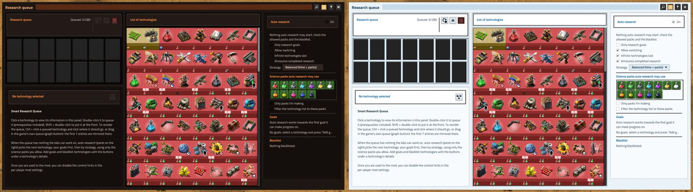
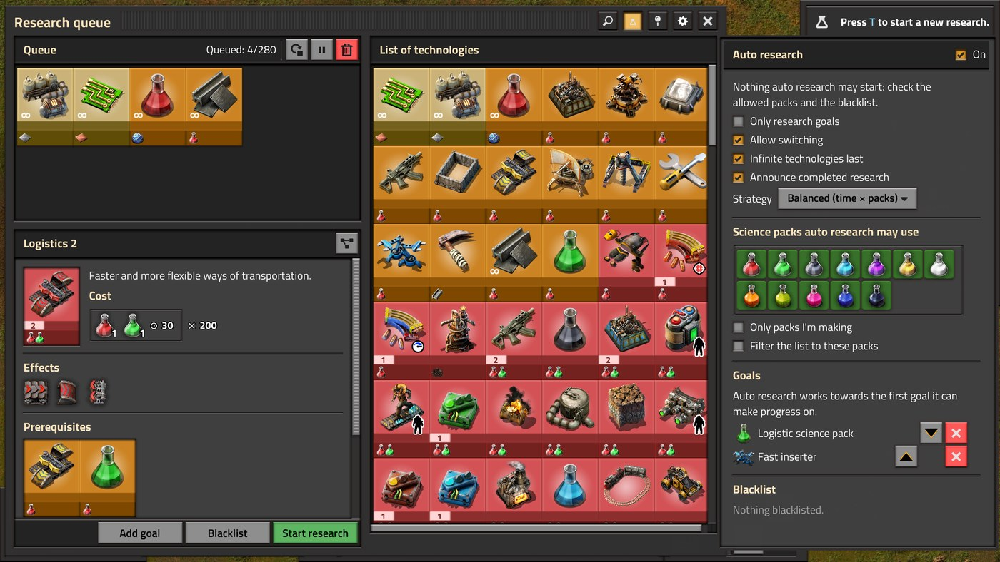

# Smart Research Queue

A Factorio 2.1 mod: [Ultimate Research Queue](https://mods.factorio.com/mod/UltimateResearchQueue)'s research
queue with [Auto Research](https://mods.factorio.com/mod/auto-research) built in.

- **Queue** technologies; their prerequisites come along. The first entries are mirrored into the game's own
  research queue, and changes made there come back.
- **Reorder**: Ctrl + click a queued technology, then click where it goes. With the
  [FSE](https://github.com/watdafawx/fse) loader and its `fse-std` mod, you can drag entries instead.
  Moves keep the queue researchable: prerequisites stay in front, dependents behind.
- **Auto research** (side panel): when the queue runs dry, research continues from your **goals** first, then by
  strategy (balanced, fast, slow, cheap, expensive, random), using only the science packs you allow, or only the
  ones you actually made in the last hour.
- Goals and a blacklist, from the technology details or the side panel; defaults from per-player settings.
- Auto Research's remote interface, so other mods that drive it keep working.

Replaces Ultimate Research Queue and Auto Research (marked incompatible, so the game won't load them together).
Works with big modpacks: technology data is cached once per load.

## Themes

The research queue window follows the theme each player picks in [FSE std](https://github.com/watdafawx/fse#themes)'s theme window (its button on the shortcut bar), when FSE std 0.6+ is installed: 12 themes, colours edited live with the FSE loader. Without FSE std it looks as before.

With FSE std 0.7.0+ the window ("Research queue", its panels **Queue** and **List of technologies**) is laid out as our other mods' windows: the gear by the close button holds its settings (Docked, Size, show disabled technologies, show control hints, Theme..., Reset size and place), and Auto Research (the science flask in the title bar, lit while its panel shows) hangs as a drawer on its right edge (untick Docked to have it as a column inside the window). Clearing the queue and un-researching ask first; Esc closes the window.



With FSE std 0.8.0+ the window is drawn at FSE std's **Window size** (per-player setting, or the theme window), or at its own **Size** from the gear, on top of the game's GUI scale. On a small screen or at a large GUI scale it takes fewer rows and columns of technologies instead of being drawn smaller: at the game's GUI scale 200 % on 2560 x 1440 it shows whole, with the Auto Research drawer beside it. When even that leaves no room beside it, the drawer opens inside the window, over the technology list (the flask shows and hides it).



## Install

Copy this folder into your mods folder (`%APPDATA%\Factorio\mods`) as `smart-research-queue`, or clone it there:

```
git clone https://github.com/watdafawx/smart-research-queue
```

Needs [flib](https://mods.factorio.com/mod/flib). `test\run.py` runs the headless tests (set `FACTORIO_EXE` if the
game isn't in a usual Steam library). `test\run_gui.py [--themed]` opens a real game window and screenshots the window
(`--themed`: with fse-std; close your own game first). At other scales: fse's `test\run_theme_matrix.py --windows srq
--scale 2 [--window-scale 150]`.

## License

MIT. Smart Research Queue is a fork of Ultimate Research Queue (Caleb Heuer) and Auto Research; both licenses are in
[LICENSE](LICENSE).
